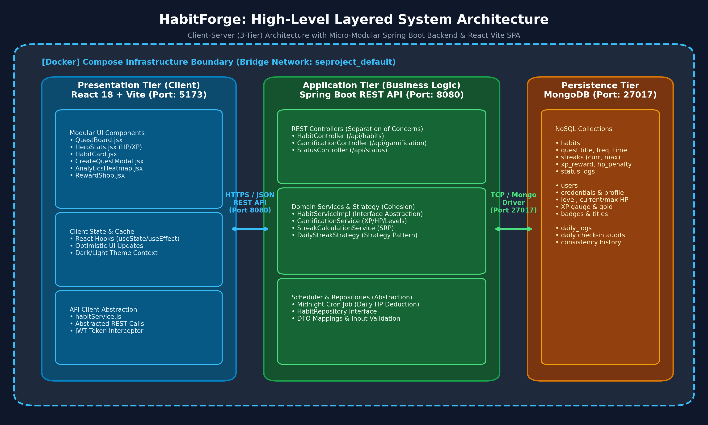
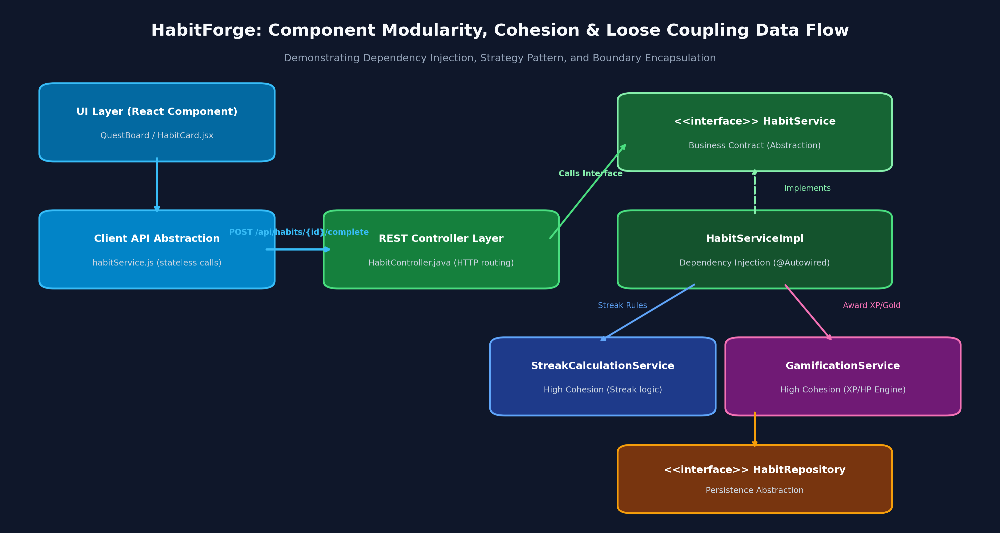
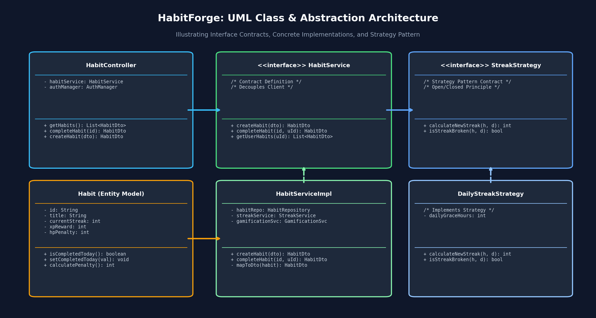

# HabitForge - Vision Document

## Project Name & Overview
**HabitForge** is a gamified productivity and habit-tracking web application. It transforms daily self-improvement into an RPG-style game where users build daily streaks to level up, and lose "Health Points" (HP) if they neglect their commitments. 

## Problem it Solves
Traditional habit trackers are often clinical, boring, and fail to provide immediate dopamine or consequences. Students and young professionals often struggle with procrastination and lack the short-term motivation required to build long-term routines. HabitForge solves this by introducing immediate virtual stakes (HP) and rewards.

## Target Users (Personas)
1. **The Procrastinator (Standard User):** Needs external motivation and a sense of urgency (losing HP) to complete daily tasks like studying or exercising.
2. **The Data Achiever (Power User):** Loves seeing their progress visualized through streak counters and historical charts to validate their consistency.

## Vision Statement
To make personal growth as engaging and addictive as a video game by applying RPG mechanics to daily real-world habits.

## Key Features / Goals
* **The Daily Quest Board:** A daily checklist of active habits.
* **Health & Experience System:** Gain XP for completing habits; lose HP when failing to complete them by midnight.
* **Streak Tracking:** Visual counters showing consecutive days of success.
* **Custom Rewards:** A "shop" where users spend earned points on real-world rewards they set for themselves (e.g., "1 Hour of Gaming").
* **Progress Analytics:** Simple charts showing completion rates over time.

## Success Metrics
* **Retention:** 40% of users return to log a habit on Day 7.
* **Engagement:** Users interact with the app at least twice a day (morning review, evening check-off).
* **System Health:** 0 missed midnight cron jobs for HP deduction.

## Assumptions & Constraints
* **Assumptions:** Users will be honest when checking off habits; users understand basic RPG terminology (HP, XP).
* **Constraints:** Must be built as a responsive web app rather than a native mobile app for V1; relying on a simple server-side cron job for daily resets.

---

## Development Setup

### Branching Strategy
This project strictly follows **GitHub Flow**:
1. The `main` branch is always deployable and stable.
2. All new development happens on descriptive feature branches (e.g., `feature/hp-system`, `feature/auth-ui`).
3. Once work is complete, a Pull Request (PR) is opened against `main` for review.
4. After approval, the branch is merged into `main` and deleted.

### Local Development Tools
* **Code Editor:** Visual Studio Code
* **Version Control:** Git & GitHub
* **Containerization:** Docker Desktop
* **API Testing:** Postman / REST Client

### Quick Start – Local Development
Ensure you have [Docker Desktop](https://www.docker.com/products/docker-desktop) installed and running.

1. Clone the repository:
   `git clone https://github.com/yourusername/habitforge.git`
2. Navigate into the project directory:
   `cd habitforge`
3. Build the Docker images and start the containers:
   `docker-compose up --build`
4. Access the application:
   * **Frontend Application:** `http://localhost:3000`
   * **Backend API (Spring Boot):** `http://localhost:8080`

---

## Software Design (DA-2 / Review 2)

### Main Design Choices Summary
HabitForge utilizes a **3-tier Layered Architecture** (Presentation, Application, and Persistence tiers) decoupled via stateless REST APIs and orchestrated through Docker Compose. High functional cohesion and low coupling are achieved across the Spring Boot backend by isolating HTTP controllers, domain business logic, and repository abstractions, with a pluggable Strategy Pattern for streak calculations. The React Vite frontend applies component-based modularity and strict service layer abstractions, delivering an RPG-style gamified experience with minimal cognitive load and instant dopamine feedback loops.

---

### 1. High-Level Architecture Diagram
The system architecture follows a clean 3-tier model where the React client communicates with the Spring Boot server over RESTful HTTPS/JSON contracts, and data persistence is handled by MongoDB.

* **Editable Diagram Source:** [docs/design/habitforge_architecture.drawio](docs/design/habitforge_architecture.drawio)
* **Architectural Style:** **Layered (3-Tier) Architecture with Client-Server RESTful Interaction**. Chosen because it enforces strict separation of concerns, enables independent scaling of frontend and backend services, simplifies automated testing, and allows future native mobile clients (React Native/Flutter) to reuse backend APIs seamlessly.

---

### 2. Component Modularity, Cohesion & Loose Coupling
The application is organized into decoupled layers and focused services following the Single Responsibility Principle:

* **Editable Diagram Source:** [docs/design/habitforge_component_flow.drawio](docs/design/habitforge_component_flow.drawio)
* **Design Principles Implemented:**
  1. **Abstraction:** Defined through clear Java interfaces (HabitService, HabitRepository, StreakStrategy) and DTOs (HabitRequestDto, HabitResponseDto) that encapsulate domain representations.
  2. **Modularity:** Separation of backend packages (controller, service, 
epository, model, dto, strategy) and frontend components (QuestBoard, HeroStats, HabitCard, habitService).
  3. **High Cohesion:** Dedicated single-responsibility classes—StreakCalculationService is strictly dedicated to streak evaluation, while GamificationService manages XP/HP calculations and leveling.
  4. **Low Coupling:** Inversion of Control via Spring Constructor Dependency Injection, avoiding concrete class dependencies.

---

### 3. UML Class Diagram & Strategy Pattern
The streak calculation logic is abstracted using the **Strategy Pattern**, allowing flexible streak evaluation rules (daily, weekly, holiday-exempt) without altering core habit services.

* **Editable Diagram Source:** [docs/design/habitforge_class_diagram.drawio](docs/design/habitforge_class_diagram.drawio)

---

### 4. User Interface Design (6 Figma Screens)
The user interface implements an RPG-gamified visual design system designed for low cognitive load and behavioral loss aversion:

| Screen | File | Key UX Rationale |
| :--- | :--- | :--- |
| **1. Daily Quest Board** | [screen1_quest_board.png](docs/design/screens/screen1_quest_board.png) | Hero HP/XP gauges, time-of-day habit chunking (Morning/Afternoon/Evening), instant check-off feedback. |
| **2. Quest Creator Modal** | [screen2_create_habit.png](docs/design/screens/screen2_create_habit.png) | Dynamic risk/reward tuning (Easy/Medium/Hard/Boss), category selectors, recurrence scheduling. |
| **3. Hero Profile & RPG Stats** | [screen3_hero_profile.png](docs/design/screens/screen3_hero_profile.png) | Character sheet with avatar, discipline attributes (Strength, Intellect, Consistency), milestone badges. |
| **4. Consistency Analytics** | [screen4_analytics_heatmap.png](docs/design/screens/screen4_analytics_heatmap.png) | 52-week GitHub-style activity heatmap, monthly completion rate bar charts, streak performance. |
| **5. The Item Bazaar (Shop)** | [screen5_reward_shop.png](docs/design/screens/screen5_reward_shop.png) | Real-world guilt-free reward exchange (e.g., gaming, cheat meal) funded by earned habit gold. |
| **6. Adventurer's Guild (Social)** | [screen6_guild_social.png](docs/design/screens/screen6_guild_social.png) | Cooperative Party Boss Raids, peer accountability activity stream, friend cheers (+5 XP). |

* **Interactive Prototype Specification:** [docs/design/FIGMA_PROTOTYPE.md](docs/design/FIGMA_PROTOTYPE.md)

---

### 5. 5 Key Architectural Decisions & Why
1. **React 18 Single-Page Application (SPA) vs Multi-Page MVC:** Enabled sub-second client-side route transitions and optimistic UI updates for habit completion, providing the responsiveness expected of a modern game.
2. **Layered Spring Boot Architecture with DTOs:** Ensures strict boundaries between web controllers, business validation, and database persistence, preventing data leakage and facilitating unit testing.
3. **Document-Oriented MongoDB Storage:** Habits and user logs feature variable attributes (custom categories, dynamic logs, badge lists) that naturally map to flexible JSON documents without complex SQL joins.
4. **Server-Authoritative Midnight Cron Scheduler:** Prevents client-side tampering by centralizing health penalty deductions and streak resets on the backend server at midnight.
5. **Stateless JWT Authentication:** Allows the application to scale horizontally in containerized cloud environments without maintaining sticky server-side sessions.
